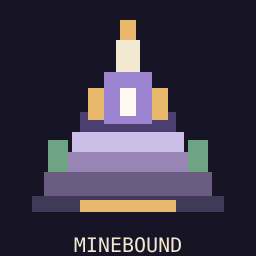

# Minebound

**An RPG inside Minecraft, without changing Minecraft combat.**

Minebound is a NeoForge **Minecraft 1.21.1** mod concept: place an Altar, open a Mario-inspired stage map, enter menu-only RPG encounters, and fight with EarthBound-inspired commands plus skill-based bullet dodging. D&D-inspired stats and an Enshrouded-inspired interconnected multiclass tree shape your character.

> **Status: early development / playable local UI prototype, not a completed multiplayer mod.** The current prototype stores progress only in client memory; world saves, trusted server simulation, level progression from Minecraft activity, actual co-op, and multiplayer ready-up are not implemented yet. Do not treat the prototype as synchronized multiplayer.



## Design pillars

- **No instanced worlds or physical RPG dungeons.** Stage nodes open encounters directly from the altar world-map screen.
- **Separate inventories/stats/combat.** No Minecraft weapons, armor, food, or potions enter Minebound, and Minebound buffs never affect normal combat.
- **Commands:** BASH / ABILITY / GOODS / DEFEND / RETREAT.
- **D&D-inspired attributes:** STR, DEX, CON, INT, WIS, CHA.
- **Free multiclassing:** Passive-heavy skill branches, with an active ability unlocked after several investments.
- **Skill-based defense:** Player hearts dodge visible attacks; normal attacks are designed to be avoidable.
- **Multiplayer target:** A **single shared arena** with one colored heart per consenting player, up to four; ready-up required before starting. **Not implemented yet.**
- **Original assets:** retro 16-bit palettes and whimsical enemies; no copied Undertale/EarthBound sprites, interface images, music, or fonts.

## Try the UI prototype

The project uses Java 21, NeoForge 1.21.1 and the NeoForged ModDevGradle plugin. Install **Gradle 9.2.1** (this initial repository does not include a Gradle wrapper JAR), then run:

```sh
gradle runClient
```

For a production build:

```sh
gradle build
```

Find the **Minebound Altar** in the Functional Blocks creative tab, or craft it with cobblestone, redstone, and an amethyst shard. Right-click the Altar to open the stage map.

Current prototype features: world-map stage selection, a five-encounter World 1, local HP/PP menus, BASH, early ABILITY gating, DEFEND, RETREAT, and a keyboard-driven local dodge minigame. Skill allocations and stages currently reset on restarting the client; this is explicitly an early visual/interaction prototype, not the persistent gameplay architecture.

## The build plan

Read [docs/GAME_DESIGN.md](docs/GAME_DESIGN.md), [docs/NETWORKING.md](docs/NETWORKING.md), and [docs/ART_DIRECTION.md](docs/ART_DIRECTION.md). The next priority is **server-owned character progression and party state**, before implementing shared multiplayer dodge collision.

Inspired by the *mechanical feel* of EarthBound, Undertale, D&D, Enshrouded and Mario; not affiliated with any of those properties.
