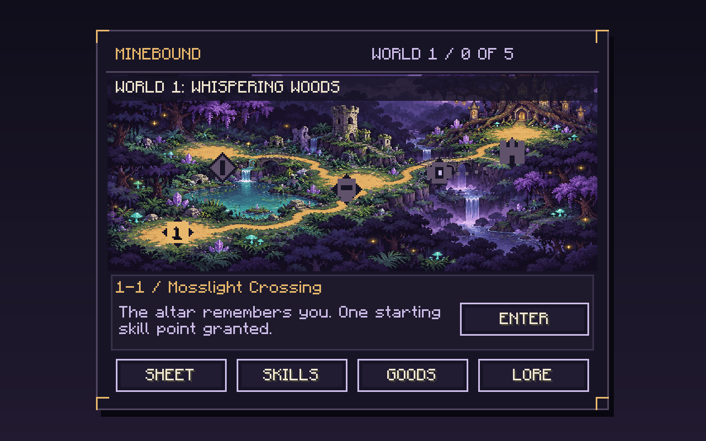
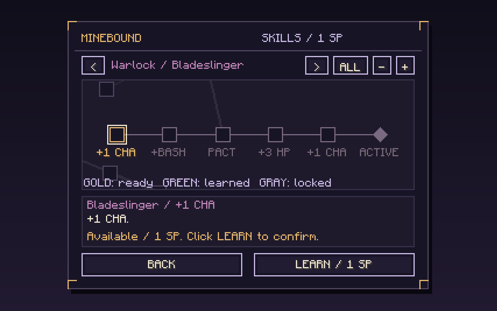
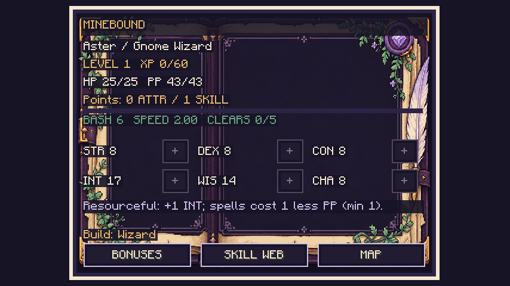

# Minebound

A menu-driven RPG for **Minecraft 1.21.1 / NeoForge 21.1.262 / Java 21**. The Minebound Altar opens the RPG; it never generates dungeons or imports vanilla equipment into combat.

Version **0.3.0** builds on the complete 0.2 overhaul. The original World 1 enemies, stage unlocks, manual dodge engine and pattern generator are retained.

## Implemented

- Server-owned character creation and profiles: four races, six starting classes (including Warlock), attributes, Adventurer levels/XP, current HP/PP, goods, skills, stage completion and lore.
- HP/PP carry across battles, altar entry, death and logout. Full recovery requires 24,000 elapsed Overworld simulation ticks; sleeping and `/time` cannot mint recoveries.
- Survival XP for natural ores, personal hostile kills, mature crops (including compatible right-click harvest/replant transitions), and fishing. Persistent category budgets, deduplication and source restrictions limit abuse.
- **88 connected skill nodes / 14 specializations**, panning, scroll zoom, distinct node shapes, prerequisites, hover details and confirmed purchases. Starting class never locks a family.
- Wizard Arcane/Fire/Ice and Warlock Psychic Blade/Destruction/Affliction, plus Warrior/Rogue/Druid/Paladin paths. Status effects, saves, finite barriers, sustain limits and cross-family bonuses affect combat.
- BASH / ABILITY / GOODS / DEFEND / RETREAT. Wizard starts with 40 base PP and Spark costs 2 before efficiency; Warlock has CHA-based melee combos and bounded PP recovery.
- Original forest-map, skill-web and folio PNG backgrounds; custom pixel controls; animated supplied enemy sprites with transparent gutters and nearest sampling.
- Intro story, World 1 stage dialogue, boss payoff, collectible lore, and a server-confirmed Creative Reset Relic.

Shared four-heart parties, invitations/readiness and co-op encounter synchronization are **not implemented**. Players currently have individually authoritative battles, including on servers. No fake party UI is provided.

## Run and build

```powershell
.\gradlew.bat runClient
.\gradlew.bat clean build
```

On Linux/macOS use `./gradlew`. The normal build runs 30 JUnit tests and creates `build/libs/minebound-0.3.0.jar`. Install the same mod on server and clients.

Place/craft an Altar or find it in Creative Functional Blocks. Create a character, select a map landmark, then press ENTER. WASD/arrows move the heart; Shift enables precision movement. Drag/scroll the skill canvas, select a node, and confirm its purchase.

## Saves and migration

Authoritative files live in `<world>/data/minebound/players/<UUID>.json`, with atomic replacement and `.bak` retention. They are independent of Minecraft player inventory and XP. Server activity XP configuration is in `<world>/serverconfig/minebound-server.toml`.

On the integrated single-player host, an existing 0.2 local profile is imported from its previous per-world/UUID location if no server profile exists. Original files and legacy path ranks/abilities remain intact. Dedicated servers never accept a client-uploaded profile. Exported version-1 progress and version-2 profiles have explicit migration paths; corrupt/future saves are not silently reset.

See [rules and balance](docs/COMBAT_AND_CHARACTERS.md), [testing XP, recovery and reset](docs/TESTING.md), [server ownership and future parties](docs/NETWORKING.md), and [art generation prompts/provenance](art/UI_ART.md).

## In-game previews

These are screenshots from the automated Minecraft client scenario, not mockups.





More: [creation](docs/screenshots/creation.png), [battle](docs/screenshots/battle.png), [reset confirmation](docs/screenshots/reset.png).
