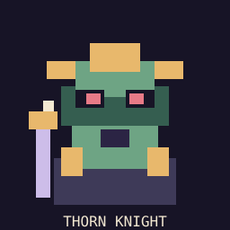

# Minebound Art Bible — early concept

**Intent:** Warm, slightly eerie whimsical 16-bit RPG pixel art, readable at Minecraft GUI scale. The interface and original SVG concepts follow this direction. Version 0.2 uses the repository owner's supplied Deltarune sheets for World 1 enemy animation; see [provenance and mapping](../art/source/world1/README.md).

## Palette (hex)
- Ink: #171426
- Deep plum: #2B2444
- Purple UI: #74649A
- Pale lavender: #CDBDE9
- Parchment: #F3E9D2
- Fern: #6EA484
- Gold: #E8B86C
- Warning: #E87A87
- Off-white: #FEF9F1

## Pixel rules
- Work at 16x16, 32x32, 64x64 integer resolutions; upscale nearest-neighbor, no blurry filtering.
- New commissioned art should follow the original Minebound concepts rather than copy another game's HUD, text, sound effects or music. The supplied sheets are documented separately.
- Use angular amethyst-gold altar insignia, asymmetrical foliage, and charming-but-slightly-sinister bosses.
- World map should look like a handmade paper gameboard, with paths/encounter tokens and stage flags.
- Party HUD: compact framed name, HP, PP, optional status icons, each heart color identifies its controlling player.
- Battle arena shared and roomy. Make danger readable even on small screens, and offer a reduced-flash mode.

## First assets to commission/create
1. 32x32 altar block sprites (all faces; Minecraft texture resource PNG)
2. 64x64 World 1 enemy portraits (Moss Sprite, Briarling, Thorn Knight, Mire Oracle, Crownroot)
3. UI nine-slice borders, tiny status icons, heart variants
4. World 1 map tiles and stage flags
5. Original chiptune-inspired sound design (no existing game audio)

### Original sketches

These SVGs are **art-direction sketches only**, not textures currently loaded by Minecraft. They can be converted to PNG/pixel-cleaned before production.
